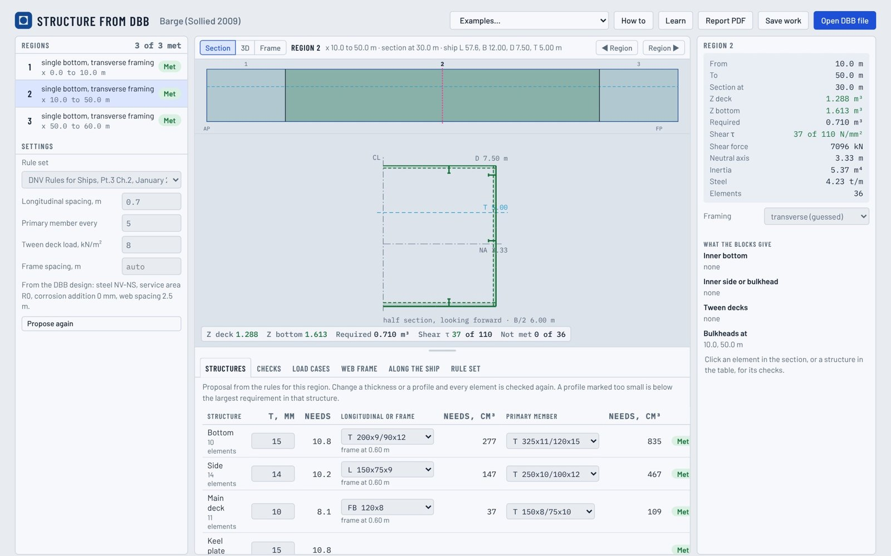

# Structure from DBB

**Open the app: [shiplab.github.io/struct](https://shiplab.github.io/struct/)** · [User manual (PDF)](https://shiplab.github.io/struct/docs/manual.pdf) · Version 1.0.0

Structure from DBB proposes and checks the main hull structure of a ship from its Design Building Block (DBB) arrangement. Open a design saved by the [Ship Design Building Block Editor](https://shiplab.github.io/dbb/), and the app splits the ship into regions at the bulkheads it finds in the blocks. It then sizes and checks each region's structure on the real hull, and analyses its transverse web frame as a beam model under load cases read from the blocks. It runs in the browser; nothing is installed and nothing leaves your computer.

> **For educational use only.** Structure from DBB is made for teaching and early concept exploration. Its results are simplified estimates. They must not be used for the design, approval or construction of any ship, for class or flag-state documentation, or for any safety-critical decision. Provided as it is, without warranty of any kind; the authors accept no liability for its use.



## What it does

- **Longitudinal structure per region.** Plates, longitudinals and primary members are sized to DNV Rules for Ships Pt.3 Ch.2 (January 2015, ships under 100 m). The hull girder section modulus is checked against the rule value along the length.
- **Framing.** Longitudinal or transverse framing is guessed per region; transverse framing applies to small ships and the ends. Floors, side frames and deck beams get estimated end brackets. The framing can be changed by hand.
- **Buckling and hull girder shear.** Plates and longitudinals under hull girder compression, with the Johnson correction, and the shear stress at the neutral axis, in simplified form.
- **Web frames.** One transverse web frame per region is modelled as a plane frame of Timoshenko beams, in the manner of Nauticus Hull 3D Beam. Its load cases (full load, ballast, tank test) are read from the blocks and can be edited, and the girders are sized from the forces. The plating is also checked as the frame's flange (biaxial buckling), and lightening holes can be given per member.
- **Transverse bulkheads.** Found in the arrangement and sized with a simplified method.
- **Learn the basics.** Eight short lessons on a box barge: loads, shear force and bending moment, section properties, stresses, rule moments, local strength, buckling, a web frame member by hand, holes and two-way loading. Each is worked by hand and checked by the app, with sliders to change the conditions and a worked solution. They follow the compendium of Sollied (2009).
- **Report and saving.** *Report PDF* writes a report of the whole ship; *Save work* keeps your changes in a .json file.

Every value can be changed by hand and is checked again at once: green is met, red is not met, and each check names its rule.

## Quick start

1. Open [shiplab.github.io/struct](https://shiplab.github.io/struct/). The barge of the compendium is loaded.
2. Pick a region in the side view or the list, and switch between *Section*, *3D* and *Frame*.
3. Change thicknesses, profiles, girders and load cases in the tabs under the drawing.
4. Try *Examples* (R/V Gunnerus, PSV, AHTS, tanker, container ship, bulk carrier), or *Open DBB file* with a design saved by the DBB editor (one hull).
5. *Learn* opens the lessons; *How to* explains each step; the [manual](https://shiplab.github.io/struct/docs/manual.pdf) covers the method, the assumptions and the limitations, with exercises for students.

## Run it yourself

The app is this folder, with no build step. Open `index.html` in a browser; it needs no internet, because Three.js and the fonts are in `vendor/`. Some browsers limit pages opened from a file. If yours does, serve the folder, for example with `python -m http.server`, and open `http://localhost:8000`.

To publish a copy, push the folder to a GitHub repository and turn on *Settings → Pages → Deploy from a branch* (main, root). The empty `.nojekyll` file makes Pages serve the files as they are.

Browsers: current Chrome, Edge, Firefox and Safari. The 3D view needs WebGL. The page follows the light or dark setting of your system.

## Limits

- One section and one web frame per region.
- Buckling (without lateral-torsional buckling), transverse frames, brackets and hull girder shear are simplified estimates.
- No fatigue, torsion or finite element analysis.
- The web frame is a symmetric half model, with no accelerations of the tank contents.
- No hatch openings, deck girders, pillars, stringers or bulb profiles yet.
- The 2015 rules are for ships under 100 m; above that the results are indicative only.

## Files

- `index.html`: the app, in one file; the DBB core, the examples and the lessons are inside.
- `docs/manual.pdf`: the user manual. `docs/screenshot.jpg`: the picture above.
- `vendor/three.min.js`, `vendor/OrbitControls.js`: [Three.js](https://threejs.org/) r147, MIT license.
- `vendor/fonts/`: Barlow, Barlow Condensed and IBM Plex Mono (latin subsets from Fontsource), SIL Open Font License 1.1.
- `CHANGELOG.md`: what is in each version. `LICENSE`: MIT.

## Citing

If you use the tool, for example in teaching material, a report or a thesis, cite the software:

Gaspar, H.M. (2026). *Structure from DBB* [Computer software], version 1.0.0. NTNU. https://shiplab.github.io/struct/

```bibtex
@software{gaspar2026structdbb,
  author       = {Gaspar, Henrique M.},
  title        = {Structure from {DBB}},
  year         = {2026},
  version      = {1.0.0},
  note         = {Web application for teaching ship structural design from a Design Building Block arrangement},
  organization = {NTNU},
  url          = {https://shiplab.github.io/struct/}
}
```

If you refer to the Design Building Block approach itself, cite: Gaspar, H.M., Fonseca, Í.A. and Andrews, D. (2024). *Wither now the Design Building Block (DBB) Approach.* International Marine Design Conference (IMDC 2024). https://doi.org/10.59490/imdc.2024.915

## Credits

Developed by Henrique Gaspar, NTNU, 2026.

- It builds on the Hull Scantlings Design Assistant made in 2018 by Olivia Chaves in her master thesis at NTNU, supervised by Henrique Gaspar and Henning Borgen.
- Parts of it are based on the compendium *Strukturdesign av skip* by Arne Jan Sollied (Høgskolen i Ålesund, 2009): the barge example and the lessons, the moment distributions, the buckling, and the plating as flange of the web frames. The cover of the compendium, shown in About, is used with his permission.
- It runs on the core of the [Ship Design Building Block Editor](https://shiplab.github.io/dbb/).
- The R/V Gunnerus example uses the open Gunnerus data (shiplab/gunnerus, CC BY-NC 4.0, courtesy of Polarkonsult and NTNU). The other examples are the illustrative designs of the DBB editor.

References:

- Chaves, O.S., Gaspar, H.M. and Borgen, H. (2018). An Open and Collaborative Knowledge-Based Approach for Automated Design of Hull Scantlings. ICSOS 2018, Gothenburg.
- Chaves, O.S. (2018). A Knowledge-Based Approach for Automated Design of Hull Scantlings. Master thesis, NTNU.
- DNV (2015). Rules for Classification of Ships, Pt.3 Ch.2, Hull Structural Design, Ships with Length less than 100 metres.
- DNV (2009). Nauticus Hull User Manual, 3D Beam, program version 11.0.
- IACS UR S11, Longitudinal strength standard.
- Sollied, A.J. (2009). Strukturdesign av skip (compendium). Høgskolen i Ålesund.

## License

MIT, see [LICENSE](LICENSE). The R/V Gunnerus example data stays under CC BY-NC 4.0. The cover of the Sollied compendium is used with his permission. Three.js and the fonts in `vendor/` keep their own licenses.
